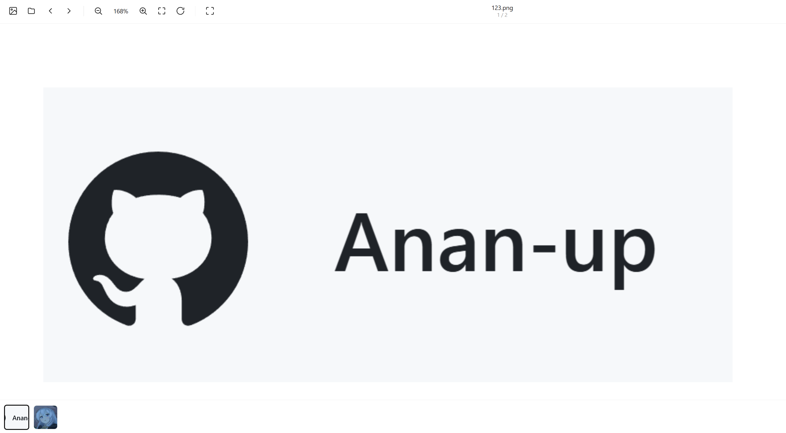

[English](README.md) | [简体中文](README_Simplified_Chinese.md) | [繁體中文](README_Classical_Chinese.md)

# Image Viewer

A **fully local, zero-upload, single-file** web image viewer. The entire application is packed into one `image-viewer.html` — double-click it and it runs in your browser. No server, no build step, no network required.

> It does one thing: viewing images. Multi-format support, free zoom / pan / rotate, and folder batch browsing. No cropping, doodling, or filters.

---

## Table of Contents

- [Quick Start](#quick-start)
- [Features](#features)
- [Keyboard Shortcuts](#keyboard-shortcuts)
- [Mouse / Touch Controls](#mouse--touch-controls)
- [Privacy & Security](#privacy--security)
- [Browser Support](#browser-support)
- [Technical Implementation](#technical-implementation)
- [Known Limits & Trade-offs](#known-limits--trade-offs)
- [File Structure](#file-structure)
- [FAQ](#faq)
- [Screenshot](#screenshot)
- [License](#license)

---

## Quick Start

1. Download `image-viewer.html` (or unzip `image-viewer.zip` to get it).
2. Open the file in a browser (double-click it, or drag it into a browser window).
3. Drag images / an entire folder into the window, or click "Select Images" / "Select Folder".

No dependencies to install, no local server to start. If you prefer to serve it over `http://` (some browsers restrict certain APIs on `file://`), run any static server in that directory, for example:

```bash
python3 -m http.server 8000
# Then open http://localhost:8000/image-viewer.html
```

---

## Features

| Category | Description |
|---|---|
| **Multi-format** | JPG / JPEG / PNG / GIF / WebP / SVG / BMP / ICO / AVIF / TIFF, subject to each browser's own decoding capability |
| **Fully local** | Images are read via `URL.createObjectURL` — **no server involved, no upload** |
| **Folder browsing** | Supports "select an entire folder" and "drag in a folder", recursively expanding subdirectories |
| **Free zoom** | Wheel / pinch / toolbar buttons, with pointer-anchored zooming |
| **Pan** | Click-and-drag; single-finger drag on touch screens |
| **Rotate** | 90° stepwise rotation, automatically re-fitting to the window afterwards |
| **Fit / Actual size** | One-click toggle between "fit to window" and "1:1 original pixels" |
| **Thumbnail strip** | Quick switching from the bottom strip; remove individual images |
| **Immersive mode** | Toolbars auto-hide when the image overflows the viewport; move the mouse / finger to the screen edge to summon them temporarily |
| **Fullscreen** | Native Fullscreen API, with a `webkit` prefix fallback |
| **Keyboard accessibility** | Complete shortcuts; thumbnails / buttons support Tab focus and screen-reader labels |
| **Smooth animation** | Eased transitions for zoom / rotate, automatically disabled while dragging and pinching to stay responsive |

---

## Keyboard Shortcuts

| Key | Action |
|---|---|
| `←` / `PageUp` | Previous image |
| `→` / `Space` / `PageDown` | Next image |
| `+` / `=` | Zoom in |
| `-` / `_` | Zoom out |
| `0` / `f` / `F` | Fit to window |
| `1` | Actual size (100%) |
| `r` / `R` | Rotate 90° clockwise |
| `Delete` / `Backspace` | Remove current image |
| `Esc` | Exit fullscreen when in fullscreen; otherwise clear all |

> When focus is on an interactive element such as a toolbar button or thumbnail, **`Space` is handled natively by that element** (e.g. activating a button) and will not be hijacked by the next-image shortcut.

---

## Mouse / Touch Controls

**Mouse**

- Wheel: zoom centered on the pointer position
- Hold left button and drag: pan
- Double-click: toggle between "fit to window" and "actual size"
- Hover the `×` at the top-right of a thumbnail: remove that image
- When zoomed in, move the cursor to the top / bottom edge of the screen: temporarily summon the toolbar

**Touch**

- Single-finger drag: pan
- Two-finger pinch: zoom (anchored on the midpoint of the two fingers, combined with overall two-finger translation)
- When zoomed in, move a finger to the top / bottom edge: temporarily summon the toolbar

---

## Privacy & Security

- **Zero upload**: Images are fed directly to `` via a local object URL created by `URL.createObjectURL(file)`. Data never leaves your machine.
- **Zero network**: The single file issues no external requests at all (no CDN, no fonts, no telemetry).
- **Resource cleanup**: On page unload (`pagehide`, excluding bfcache scenarios), all object URLs are revoked via `revokeObjectURL` to prevent memory leaks.

---

## Browser Support

Aimed at all modern browsers (Chromium / Firefox / Safari and mobile):

- Uses `ResizeObserver` to cache geometry, avoiding forced synchronous layout every frame.
- The Fullscreen API binds both the standard event and `webkitfullscreenchange`.
- Dragged-in folders are read recursively with `webkitGetAsEntry()` (widely supported in modern browsers).

---

## Technical Implementation

A few key design points, for future maintenance:

### 1. A single transform, with the origin pinned to the top-left

All zoom / pan / rotate operations are combined into one CSS `transform`:

```css
.stage { transform-origin: 0 0; }
```

```js
stage.style.transform =
  `translate(${tx}px, ${ty}px) scale(${scale}) rotate(${rot}deg)`;
```

Inside `.stage`, the image self-centers with `translate(-50%,-50%)`, so that `(tx, ty)` is always exactly "the image center in viewport coordinates". Zoom / rotate math is therefore completely decoupled from it.

### 2. Pointer-anchored zoom

Let `m` be the pointer's screen coordinates, `T` the current translation, and `k` the zoom factor:

```
T' = m - k · (m - T)
```

This formula keeps the image point under the pointer stationary before and after zooming (`k = 1` is identity, with no jump).

### 3. Cached geometry, eliminating per-frame layout thrashing

```js
let vp  = { left, top, w, h };   // viewport rect (getBoundingClientRect), maintained by ResizeObserver
let win = { w, h };              // window size
const BAR = 54;                  // top toolbar height
```

`pointermove` during dragging / pinching only reads the cache, never triggering forced synchronous layout.

### 4. Decoupling fit-scale from immersive state (avoiding oscillation)

The **baseline height used by `computeFitScale()` is fixed at `win.h - BAR`** (the non-immersive viewport height), not the live `vp.h`:

```js
function computeFitScale(){
  const rotated = ((rot % 180) + 360) % 180 === 90;
  const w = rotated ? imgDim.h : imgDim.w;
  const h = rotated ? imgDim.w : imgDim.h;
  return Math.min(win.w / w, Math.max(0, win.h - BAR) / h);
}
```

Otherwise an infinite loop emerges: enter immersive mode → viewport becomes taller → `fitScale` grows → the "already zoomed in" check flips → exit immersive mode → … causing the toolbar to flicker. This baseline, together with the criterion in `updateChrome()` and the `lastWasFit` check, all go through `fitScaleClamped()` (i.e. additionally constrained by `MIN_SCALE` / `MAX_SCALE`), keeping all three consistent.

### 5. Gesture state machine

`pointers: Map<pointerId, {x, y}>` tracks every pointer and dispatches by count:

| Pointer count | Behavior |
|---|---|
| 1 | Pan |
| 2 | Pinch zoom |
| ≥3 | Ignore extra fingers, freeze the current zoom baseline (to avoid jitter) |

On release, it steps down one level at a time: `3 → 2` unconditionally rebuilds the pinch baseline, `2 → 1` becomes pan, `1 → 0` ends the gesture and restores transition animation — ruling out any frozen "neither dragging nor zooming" state.

---

## Known Limits & Trade-offs

- **`fit()` is off by one frame in immersive mode**: zoom is computed against `win.h - BAR` while centering uses the live `vp.h`, so there may be a one-frame slight offset on entering / leaving immersive mode. It is consistent immediately afterwards, and practically invisible.
- **De-duplication between dragged-in files and the folder picker**: the de-dup key includes `webkitRelativePath`, so an image from the "folder picker" and the same-named file dragged in directly may be treated as two records (the path is empty when dragged in).
- **Newly added images are appended, not globally re-sorted**: on repeated loads, new images are appended at the end (each batch internally ordered), leaving the order of already-loaded items untouched so as not to invalidate `state.index`.
- **`MAX_SCALE` cap**: extremely small images (e.g. a 2×2 icon) are capped at `60×` when fitting to the window, rather than being scaled up to an absurd ratio.

---

## File Structure

```
.
├── image-viewer.html   # The entire implementation (HTML + CSS + JS, single file)
├── image-viewer.zip    # Packaged build of the above single file
└── README.md           # This document
```

---

## FAQ

**Q: Will the images I select or view be uploaded?**
No. Local object URLs are used throughout, and there is no upload / network request logic anywhere in the code. It works offline.

**Q: Why do some images fail to open?**
Decoding is up to the browser — for instance, some browsers do not support TIFF / AVIF. Corrupted or unsupported files are skipped automatically.

**Q: Do the icons need to go into the zip?**
No. All icons are inline SVG, with no external resources.

**Q: I want to change the shortcuts / zoom steps?**
Search for `MIN_SCALE` / `MAX_SCALE` (zoom range), `1.15` / `1.3` (wheel and button steps), and the `keydown` listener near the end of the file (shortcut mappings).

---

## Screenshot



## License

[MIT](LICENSE)
